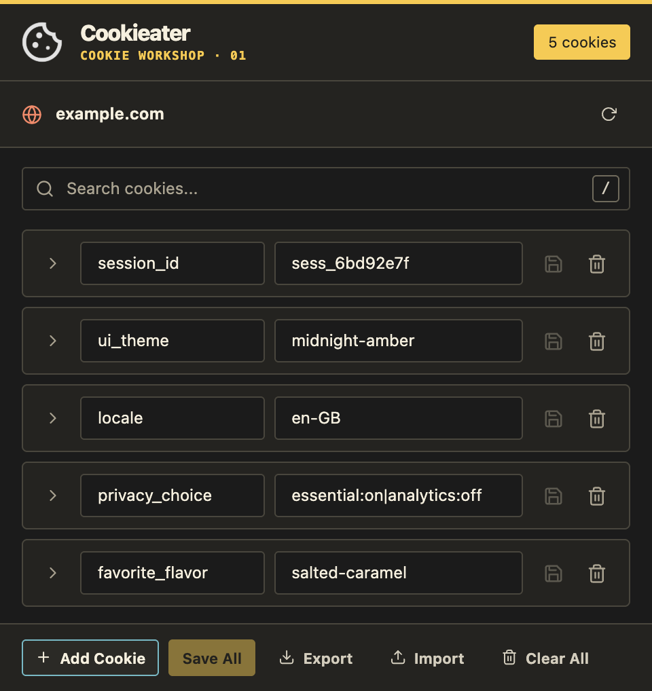
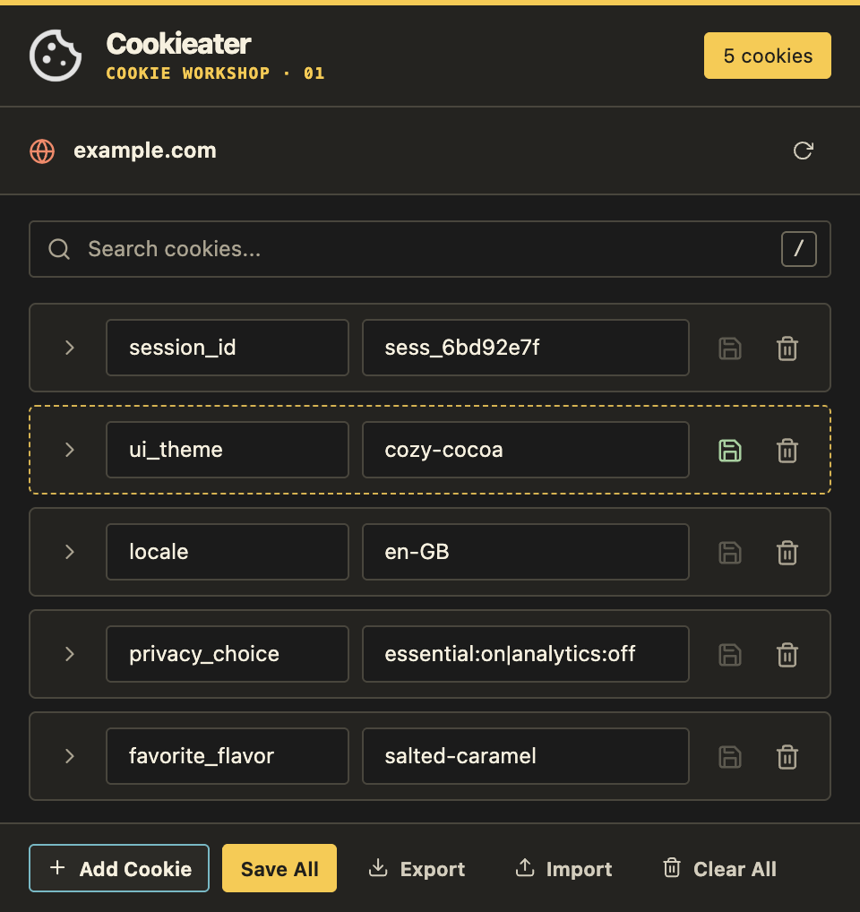
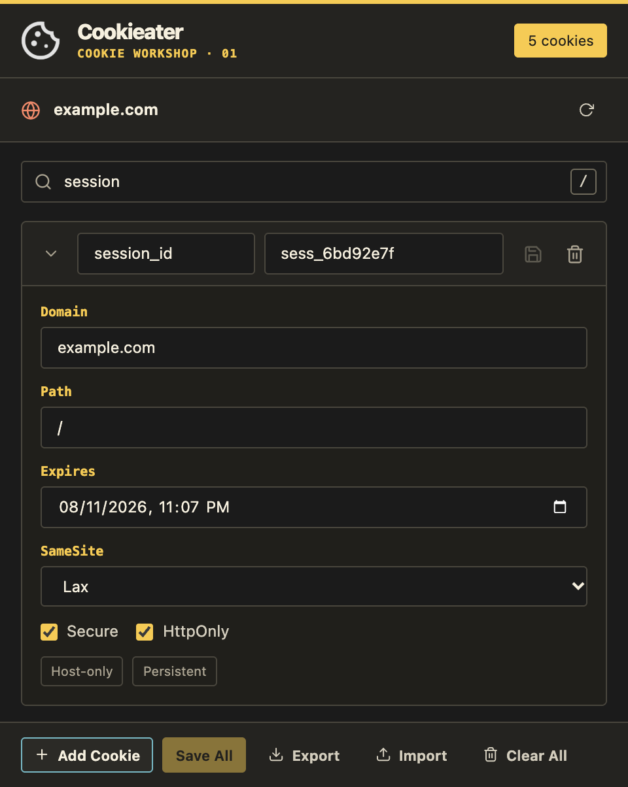
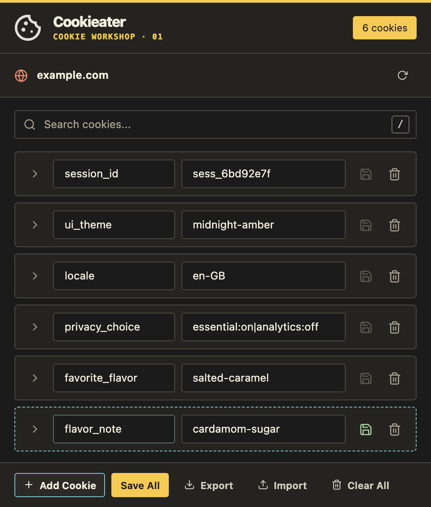

# Cookieater

A friendly Chrome extension for viewing, searching, and editing cookies on the
current site. Add, update, import, export, or remove cookies from one compact
popup.



## Install

### From source

Requires Node.js and pnpm.

```sh
git clone https://github.com/mdopeace/cookieater
cd cookieater
pnpm install
pnpm build
```

In Chrome, open `chrome://extensions`, enable **Developer mode**, choose **Load
unpacked**, and select `.output/chrome-mv3`.

## Requirements

- Chrome or a Chromium-based browser with Manifest V3 extension support

## Features

- View cookies for the active site's domain and refresh the list on demand
- Search cookie names, values, and domains as you type
- Edit a cookie's name, value, domain, path, expiration, SameSite, Secure, and
  HttpOnly settings, then save it individually
- Add a cookie, or delete one cookie at a time
- Import cookies from a JSON array and export the current domain's cookies as JSON
- Clear all cookies for the current domain after confirmation

## Screens

<p align="center">
  
  
  
</p>

All screenshots use illustrative `example.com` data, not cookies from a real
browsing session.

## Privacy and permissions

Cookieater handles cookie data locally in your browser; it does not send your
data to a Cookieater server. See the [privacy policy](PRIVACY.md).

- `cookies` — use the browser's cookie API to read and write cookies.
- `<all_urls>` — identify the active tab's hostname and access cookies on sites.

## License

[MIT](LICENSE)

## Contributing

See [CONTRIBUTING.md](CONTRIBUTING.md) for development and validation steps.
Maintainers can find release instructions in
[docs/releasing.md](docs/releasing.md).
